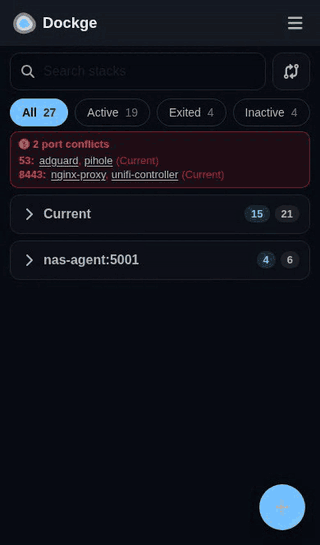
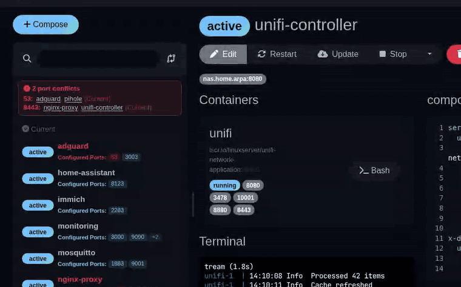

<div align="center" width="100%">
    
</div>

# Dockge

A fancy, easy-to-use and reactive self-hosted docker compose.yaml stack-oriented manager.

<a href="https://github.com/darthrater78/dockge/releases"></a>

[](https://github.com/darthrater78/dockge) [](https://github.com/darthrater78/dockge/releases) [](https://github.com/darthrater78/dockge/commits/master/)

> **Dockge is [Louis Lam](https://github.com/louislam)'s project** (he also created [Uptime Kuma](https://github.com/louislam/uptime-kuma)). This is a fork of [Chris Cooper's fork](https://github.com/cmcooper1980/dockge), with a REST API from [finder39's fork](https://github.com/finder39/dockge). If you like Dockge, please ⭐ the [original project](https://github.com/louislam/dockge) too. [More about this fork](docs/upstream.md).

**Jump to:** [🔧 Install](#install) · [🔄 Update](#update) · [⬆️ Already running Dockge?](#upgrade) · [📚 Docs](#docs) · [📋 Release notes](#release-notes)

## 🆕 What's new

**2.4.2** (2026-10-31) fixes the server's dependency advisories (body-parser, a High denial of service) and goes back to upstream's mount layout: the quickstart mounts only Dockge's data folder and the stacks folder. Installs made with the 2.4.0 or 2.4.1 quickstart can switch back [without moving any data](#bind-roots).

Recent releases: Dockge can run as a regular user (2.4.0), a phone layout built around find → open → act, a resizable desktop stack list, and port conflicts you can't miss (2.3.x). All versions: [CHANGELOG.md](CHANGELOG.md).

<table>
  <tr>
    <td align="center" width="30%"><br /><b>Phone</b></td>
    <td align="center"><br /><b>Desktop</b></td>
  </tr>
</table>

## ⭐ Features

- 🧑‍💼 Create, edit, start, stop, restart, update and delete your `compose.yaml` stacks, with an interactive editor and web terminal
- 📙 File based: your compose files stay on your drive, and normal `docker compose` commands keep working
- 🕷️ Several Docker hosts (agents) in one interface
- 📱 A phone layout built for one hand, and a resizable stack list on desktop
- 🚦 Port conflicts: a banner for ports published twice, and a check on Save and Deploy
- 🔄 Compose Drift Check: find services whose running image differs from the compose file, and sync it back
- 👤 Runs as a regular user with `PUID`/`PGID`
- 🔑 Two-factor login (TOTP), optional Cloudflare Turnstile CAPTCHA
- 🌐 [REST API](#rest-api) and a [Home Assistant integration](docs/install.md#optional-home-assistant-integration-hacs)
- 🏪 Convert `docker run ...` commands into `compose.yaml`

The full tour, with screenshots of each screen: [docs/features.md](docs/features.md).

<a id="install"></a>

## 🔧 Install

Needs Docker 20+ (or Podman with `podman-docker`) on Linux, on amd64, arm64 or armv7. Details: [requirements](docs/install.md#requirements).

This sets Dockge up in `/opt/docker/dockge`, with your stacks in `/opt/docker/stacks`, on port 5001:

```bash
{
D=/opt/docker/dockge; S=; docker ps >/dev/null 2>&1 || S=sudo
# Create Dockge's folder and the stacks folder (needs root under /opt) and make them yours
sudo mkdir -p "$D" /opt/docker/stacks && sudo chown "$USER": "$D" /opt/docker/stacks &&
# Download the compose file
curl -fsSL https://raw.githubusercontent.com/darthrater78/dockge/master/compose.yaml -o "$D/compose.yaml" &&
# Choose where Dockge listens: this machine's LAN IP (suggested), another IP, or 'all' interfaces
IP=$(ip -4 route get 1.1.1.1 2>/dev/null | sed -n 's/.* src \([0-9.]*\).*/\1/p') &&
read -rp "Listen on which IP? [Enter = ${IP:-all}, or type an IP, or 'all']: " A </dev/tty &&
A=${A:-${IP:-all}} && case "$A" in
  all) BIND=; URL_IP=${IP:-localhost} ;;
  *[!0-9.]* | "") echo "Not an IPv4 address: $A"; false ;;
  *) BIND="$A:"; URL_IP=$A ;;
esac &&
sed -i -E "s#^( *- )([0-9.]+:)?5001:5001#\1${BIND}5001:5001#" "$D/compose.yaml" &&
# Start Dockge and wait (up to 2 minutes) until it answers; connection errors while it starts are expected
$S docker compose -f "$D/compose.yaml" up -d && printf "Waiting for Dockge to start" &&
for i in $(seq 1 60); do curl -fs -o /dev/null "http://$URL_IP:5001/" && break; printf "."; sleep 2; done && echo &&
curl -fs -o /dev/null "http://$URL_IP:5001/" && echo "✅ Dockge is up: http://$URL_IP:5001" \
  || echo "❌ Stopped: no answer from http://$URL_IP:5001 (Dockge's log: $S docker compose -f $D/compose.yaml logs)"
cd "$D"
}
```

Paste it as a whole: the `{ }` makes your shell read every line before running any, so the IP question waits for you. Press Enter to accept your LAN IP (so Dockge isn't reachable on other interfaces, such as a VPN or a public one), type a different IP, or type `all`.

Dockge then runs as user `1000:1000` and sees only its data folder and `/opt/docker/stacks`, like upstream. Already have Dockge in another folder (such as `/opt/dockge`)? Nothing needs to move. Another stacks folder or port: see [docs/install.md](docs/install.md#other-stacks-folders-or-ports).

<details>
<summary><b>Or copy the compose file by hand</b></summary>

Save this as `/opt/docker/dockge/compose.yaml` (create the folders first: `sudo mkdir -p /opt/docker/dockge /opt/docker/stacks && sudo chown "$USER": /opt/docker/dockge /opt/docker/stacks`), then run `docker compose up -d` in that folder:

```yaml
services:
  dockge:
    image: ghcr.io/darthrater78/dockge:2.4.2
    restart: unless-stopped
    ports:
      - 5001:5001
    volumes:
      - /var/run/docker.sock:/var/run/docker.sock
      - /opt/docker/dockge/data:/app/data
      - /opt/docker/stacks:/opt/docker/stacks
    environment:
      - PUID=1000
      - PGID=1000
      - DOCKGE_STACKS_DIR=/opt/docker/stacks
    read_only: true
    tmpfs:
      - /tmp
    security_opt:
      - no-new-privileges:true
    cap_drop:
      - ALL
    cap_add:
      - CHOWN
      - DAC_OVERRIDE
      - FOWNER
      - SETUID
      - SETGID

# ports: 5001 is Dockge's web UI (host:container).
#   To listen on one address only: 192.168.1.10:5001:5001
# /var/run/docker.sock: lets Dockge run docker compose for your stacks
#   (root-equivalent access to Docker).
# /opt/docker/dockge/data: Dockge's database and settings (login, agents,
#   API keys, registry logins). Back this folder up.
# /opt/docker/stacks: your stacks. Both sides MUST be the same full path.
#   Dockge sees only this folder, not your apps' data elsewhere.
# PUID/PGID: the user Dockge runs as. It starts as root only to take ownership
#   of its own folders and join the docker.sock group, then switches to this
#   user. Remove both lines to run as root like versions before 2.4.0.
# DOCKGE_STACKS_DIR: where Dockge looks for stacks. Missing ./relative
#   bind-mount folders inside a stack are created, owned by PUID/PGID.
# read_only/tmpfs: the image can't be changed at runtime; scratch files go
#   to /tmp in memory.
# security_opt/cap_drop/cap_add: no privilege escalation, and only the
#   capabilities the start-up step needs; Dockge itself runs with none.
# Optional, under environment:
#   - TURNSTILE_SITE_KEY=... and - TURNSTILE_SECRET_KEY=...: CAPTCHA on login
#   - DOCKGE_ALLOW_FRAMING=true: allow embedding in a dashboard iframe
# Bind-mount folders outside the stacks folder (such as /opt/docker/<app>) are
#   created by Docker, owned by root, as upstream. If the app runs as a regular
#   user, create its folder first (mkdir -p, then chown).
# Installed with the 2.4.0 or 2.4.1 quickstart (it mounted /opt/docker:/opt/docker)?
#   See "Installed with the 2.4.0 or 2.4.1 quickstart?" in the README.
```

</details>

<a id="update"></a>

## 🔄 Update

The compose file pins a release, so an update never happens by surprise. Run this on the Docker host, with `V` set to the [latest release](https://github.com/darthrater78/dockge/releases/latest):

```bash
V=2.4.2; F=/opt/docker/dockge/compose.yaml
S=; docker ps >/dev/null 2>&1 || S=sudo; $S docker pull ghcr.io/darthrater78/dockge:$V \
  && $S sed -i.bak -E "s#(ghcr\.io/darthrater78/dockge:)[^[:space:]]+#\1$V#" "$F" \
  && $S docker compose -f "$F" up -d dockge && $S docker compose -f "$F" ps dockge \
  && echo "✅ Dockge updated to $V" || echo "❌ Update stopped: see the error above"
```

It pulls the new image first (and stops if that version doesn't exist), changes only the image tag in your compose file (keeping the old one as `compose.yaml.bak`), and recreates the Dockge container. Your stacks keep running. Roll back with `mv /opt/docker/dockge/compose.yaml.bak /opt/docker/dockge/compose.yaml` and the same `docker compose -f … up -d dockge`.

Compose file somewhere else, or want `:latest`? See [Updating: other setups](docs/install.md#updating-other-setups).

<a id="upgrade"></a>

## ⬆️ Already running Dockge?

- **Coming from before 2.4.0:** updating only the image tag keeps Dockge running as root, as before. To run it as a regular user with the hardened compose file, use the migration script: [Upgrading to 2.4.0](docs/install.md#upgrade).
- <a id="runtime"></a>**What `PUID`/`PGID` do:** Dockge fixes the ownership of its own folders, joins the docker.sock group and drops root. Your apps' data is never touched. [Running as a regular user](docs/install.md#runtime).
- <a id="bind-roots"></a>**Installed with the 2.4.0 or 2.4.1 quickstart** (it mounted all of `/opt/docker`)? [`extra/narrow-bind-root.sh`](docs/install.md#bind-roots) switches you to the upstream layout without moving any data.

<a id="docs"></a>

## 📚 Docs

| Page | What's in it |
|---|---|
| [docs/install.md](docs/install.md) | Requirements, `PUID`/`PGID` and hardening, upgrading and migration, Turnstile, iframe embedding, Home Assistant |
| [docs/features.md](docs/features.md) | Every screen, on phone and desktop, and the full feature list |
| <a id="rest-api"></a>[docs/api.md](docs/api.md) | REST API: authentication, endpoints, examples, agent compatibility |
| <a id="upstream-differences"></a>[docs/upstream.md](docs/upstream.md) | Differences from upstream (and switching back), how Claude Code built this fork, cherry-picked community work |
| <a id="release-notes"></a>[CHANGELOG.md](CHANGELOG.md) | Release notes for every version |
| [SECURITY.md](SECURITY.md#security-architecture) | How Dockge handles security, and how to report an issue |

## 🗣️ Community

- **Bugs and questions:** [GitHub issues](https://github.com/darthrater78/dockge/issues)
- **Security issues:** please report privately: [new advisory](https://github.com/darthrater78/dockge/security/advisories/new)
- **Translations:** [translation guide](frontend/src/lang/README.md)
- **Pull requests:** read the [contributing guide](CONTRIBUTING.md) first, as not every kind of PR is accepted

## FAQ

**"Dockge"?** A word Louis coined: it should sound like "Dodge", though "Dockage" is fine too. The idea came from Twitch emotes like `sadge` and `bedge`.

**Can I manage a single container without `compose.yaml`?** No: Dockge uses `compose.yaml` for everything. For single containers, use Portainer or the Docker CLI.

**Can I manage existing stacks?** Yes. Stop the stack, move its compose file to `/opt/docker/stacks/<stackName>/compose.yaml` (your `DOCKGE_STACKS_DIR`), then choose **Scan Stacks Folder** in Dockge's top-right menu.

**Is Dockge a Portainer replacement?** If you manage everything with docker compose, it can be. It doesn't manage networks or single containers. You can run both side by side.

Dockge is built on [Compose V2](https://docs.docker.com/compose/migrate/) (`compose.yaml`, also known as `docker-compose.yml`). *Motivation, from Louis's original README:* Portainer's stack deployment sometimes spun for minutes without progress or gave unclear errors.
