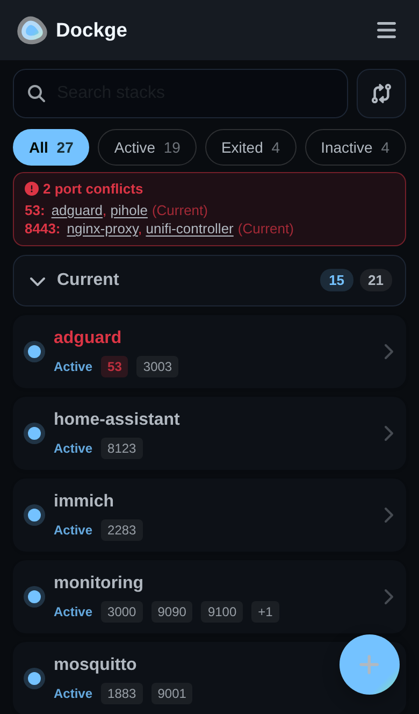
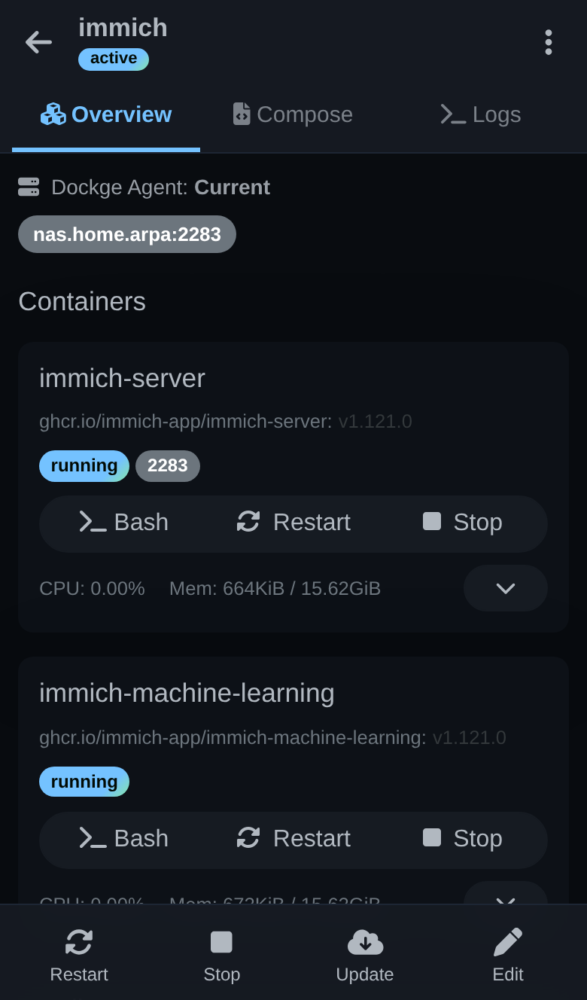
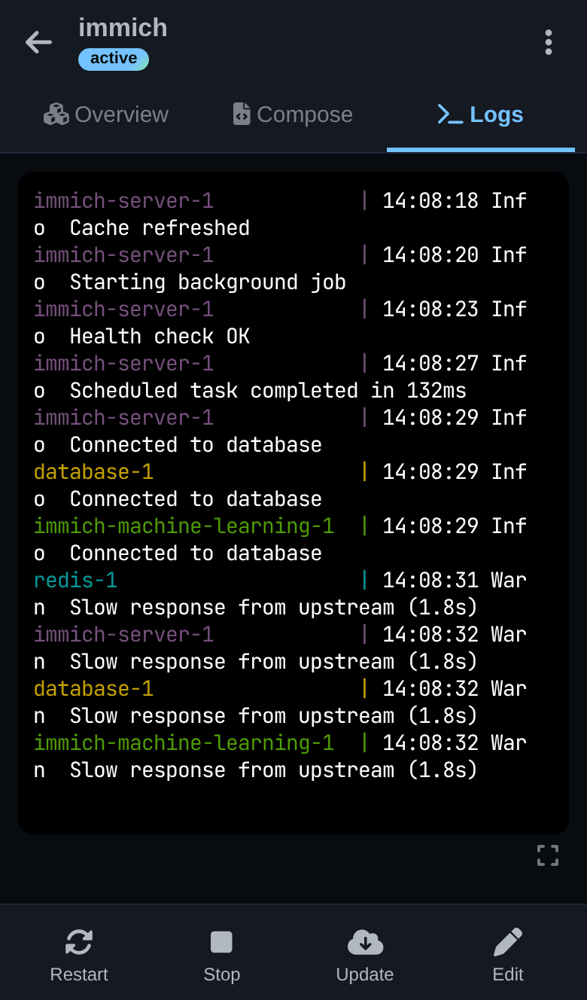
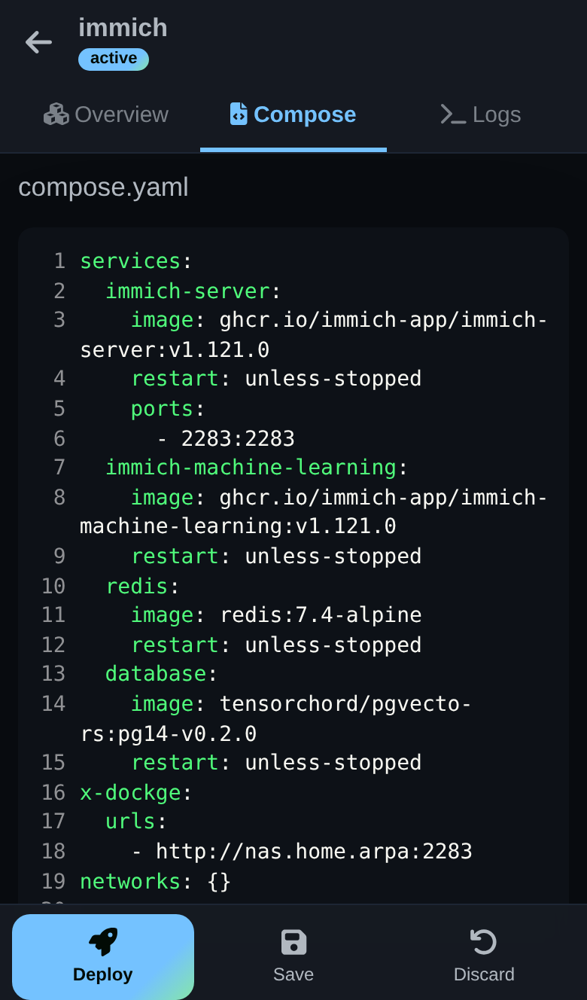
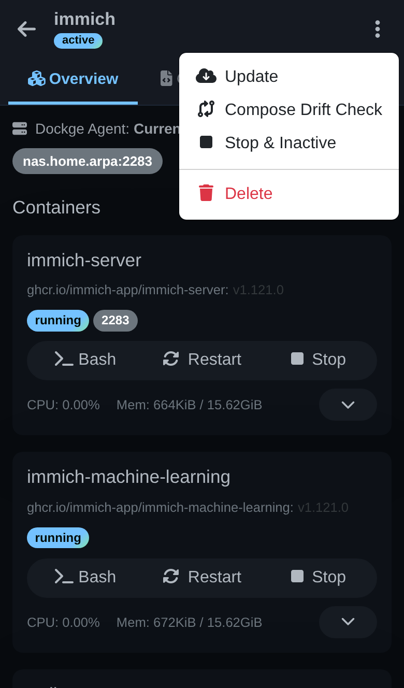
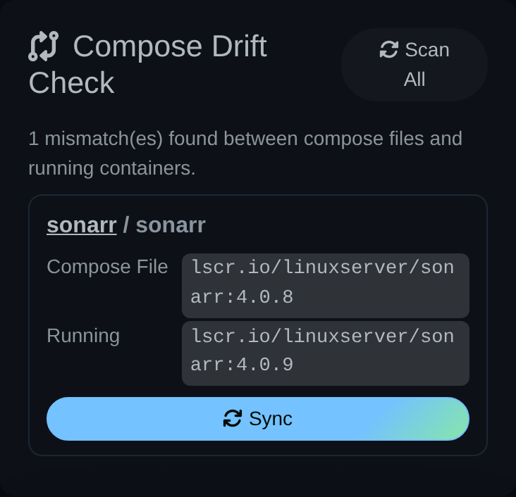
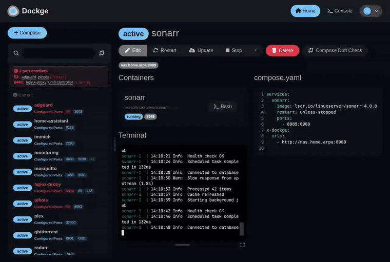
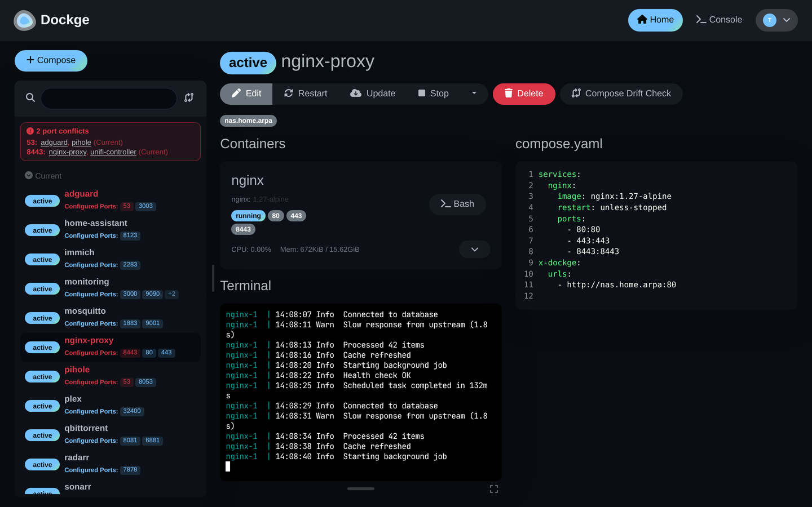
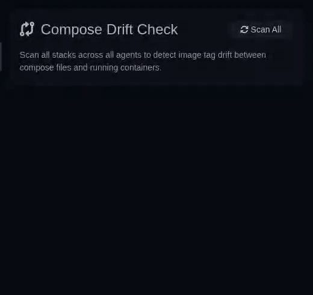
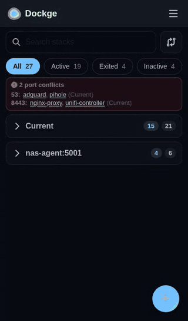

# Features

A tour of what this fork adds, with screenshots. Back to the [README](../README.md).

## 📱 Mobile

On a phone, Dockge is built around one job: **find a stack → open it → edit it or act on it → watch what happens.**

  

<table>
  <tr>
    <td align="center" width="33%"> <b>Find</b></td>
    <td align="center" width="33%"> <b>Open</b></td>
    <td align="center" width="33%"> <b>Watch</b></td>
  </tr>
  <tr>
    <td align="center"> <b>Edit</b></td>
    <td align="center"> <b>More actions</b></td>
    <td align="center"> <b>Drift check</b></td>
  </tr>
</table>

- **The stack list is the home screen.** Search by stack name, agent or port; filter by status (Active / Exited / Inactive, with counts) or by **Port conflicts**. Each stack is one card: status, name and its host ports, conflicting ports first and in red.
- **One section per agent.** With more than one Dockge agent, stacks are grouped under a collapsible header per agent showing running / total counts. Sections start collapsed; searching or filtering opens them so matches are never hidden.
- **Port conflict banner** at the top of the list names each conflicting port and the stacks publishing it (tap a name to open that stack).
- **Stack page:** a top bar with back, name and status, and a ⋮ menu for the less common actions (Update, Compose Drift Check, Down, Delete). Three tabs:
  - **Overview:** which agent the stack runs on, its URLs, and each container with its status, ports and Bash / Restart / Stop.
  - **Compose:** `compose.yaml`, `.env` and `compose.override.yaml` when present.
  - **Logs:** the combined stack log, filling the screen (expandable to full screen).
- **Bottom action bar**, where your thumb is: **Start** or **Restart**, **Stop**, **Update**, **Edit**. While editing it becomes **Deploy**, **Save** and **Discard**. Any action switches to the Logs tab so you see its output live, and the tab shows a dot while it runs.
- **Menu (☰)** for Stacks, Overview, Compose Drift Check, Console, Settings, Scan Stacks Folder and Logout, so the bottom of the screen is free for the stack actions.
- **Compose Drift Check** is one tap away (the button beside the search box); on a phone its results are cards with the compose and running image and a Sync button.

## 🖥️ Desktop

**Resizable stack list.** Drag the handle between the stack list and the page to make the list wider or narrower (arrow keys work when the handle is focused; double-click resets it). The width is remembered. Port badges show as many ports as fit the current width, with the rest behind "+N", and a conflicting port is always shown first. When the list gets narrow, the Compose Drift Check button shrinks to its icon so the search box keeps its room.

  

**Resizable terminals** (since 2.2.0). Every terminal panel (stack logs, console, container shell) has a drag handle to make it taller and a button to expand it to full screen; Esc restores it. Each page remembers its own height.

  

**Port conflicts at a glance.** The banner above the stack list lists every host port that more than one running stack publishes, per agent, with links to the stacks involved.

  

## 🔄 Compose Drift Check

Compose Drift Check (added in this fork in 1.7.0) finds services whose `compose.yaml` pins a different image tag than the container actually running, and **Sync** writes the running tag back into the compose file (comments preserved). In 2.3.0:

- **"Scan All" no longer times out.** It used to run `docker ps` plus two `docker inspect` calls *per container, for every stack*, so any host with more than a handful of containers hit the 30-second limit. A scan now makes three docker calls in total and finishes in a couple of seconds.
- **On phones** it's one tap from the stack list (the button beside the search box, or ☰ → Compose Drift Check), and per stack from the ⋮ menu.
- **Results fit the space.** Each mismatch is a card (stack / service, compose image, running image, Sync) on phones and whenever the panel is too narrow for the table, so the Sync button is never scrolled out of view.

<table>
  <tr>
    <td align="center"> <b>Desktop:</b> Scan All, then Sync</td>
    <td align="center"> <b>Phone:</b> from the stack list</td>
  </tr>
</table>

---

View Video: https://youtu.be/AWAlOQeNpgU?t=48

## Feature list

- 📱 (2.3.0 🆕) Mobile-first phone layout — find a stack, edit it, act on it and watch its logs, all within thumb reach ([details](#mobile))
- ↔️ (2.3.0 🆕) Resizable stack list on desktop, with port badges that fill whatever width you give it ([details](#desktop))
- 🚦 (2.3.0 🆕) Port conflict banner — every host port published by more than one running stack, and which stacks they are
- 🛑 (2.3.1 🆕) Port check on Save and Deploy — warns when a host port is already used by another stack (running or not) or a running container, including ports set through `.env` variables, `compose.override.yaml` and port ranges
- 👤 (2.4.0 🆕) Runs as a regular user — set `PUID`/`PGID` and Dockge fixes the ownership of its own folders, then drops root ([details](install.md#runtime))
- 📁 (2.4.0 🆕) Creates a stack's missing bind-mount folders inside the stack before it starts, owned by Dockge's user, so containers can write to them without a `chown` (folders outside the stacks folder are left to Docker, as upstream)
- ✅ (2.4.0 🆕) Save checks the compose file with `docker compose` first and keeps the old file if the new one is invalid
- 🛡️ (2.4.1) Security update: Node.js 22.23.4 and a rebuilt healthcheck ([release notes](https://github.com/darthrater78/dockge/releases/tag/v2.4.1))
- 🛡️ (2.4.2) Dependency security fixes, and Dockge mounts only its data and stacks folders, as upstream ([release notes](https://github.com/darthrater78/dockge/releases/tag/v2.4.2))
- 🧑‍💼 Manage your `compose.yaml` files
  - Create/Edit/Start/Stop/Restart/Update/Delete
- ⌨️ Interactive Editor for `compose.yaml`
- 🦦 Interactive Web Terminal
- 🕷️ (1.4.0 🆕) Multiple agents support - You can manage multiple stacks from different Docker hosts in one single interface
- 🏪 Convert `docker run ...` commands into `compose.yaml`
- 📙 File based structure - Dockge won't kidnap your compose files, they are stored on your drive as usual. You can interact with them using normal `docker compose` commands
- 🧩 (1.5.1 🆕) Compose override editor - Edit `compose.override.yaml` alongside your main compose file, when present
- 🔐 (1.5.1 🆕) Optional Cloudflare Turnstile CAPTCHA on login
- 🌐 (1.6.0 🆕) REST API for external automation (CI/CD, scripts, monitoring)
- 🔄 (1.7.0 🆕) Compose Drift Check — detect and fix image tag drift between running containers and compose files (2.3.0: fast "Scan All", works on phones — [details](#drift-check))
- 🔑 (1.9.0 🆕) Two-Factor Authentication (TOTP) — protect your account with app-based 2FA

- 🚄 Reactive - Everything is just responsive. Progress (Pull/Up/Down) and terminal output are in real-time
- 🐣 Easy-to-use & fancy UI - If you love Uptime Kuma's UI/UX, you will love this one too

## Upstream screenshots

